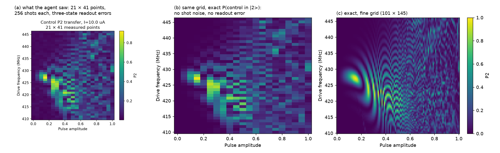
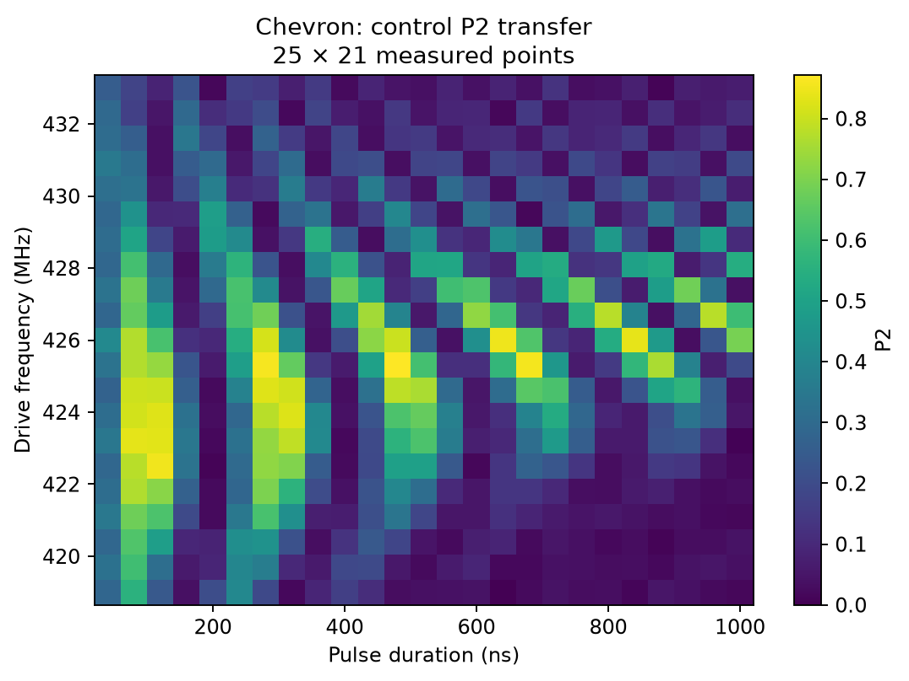
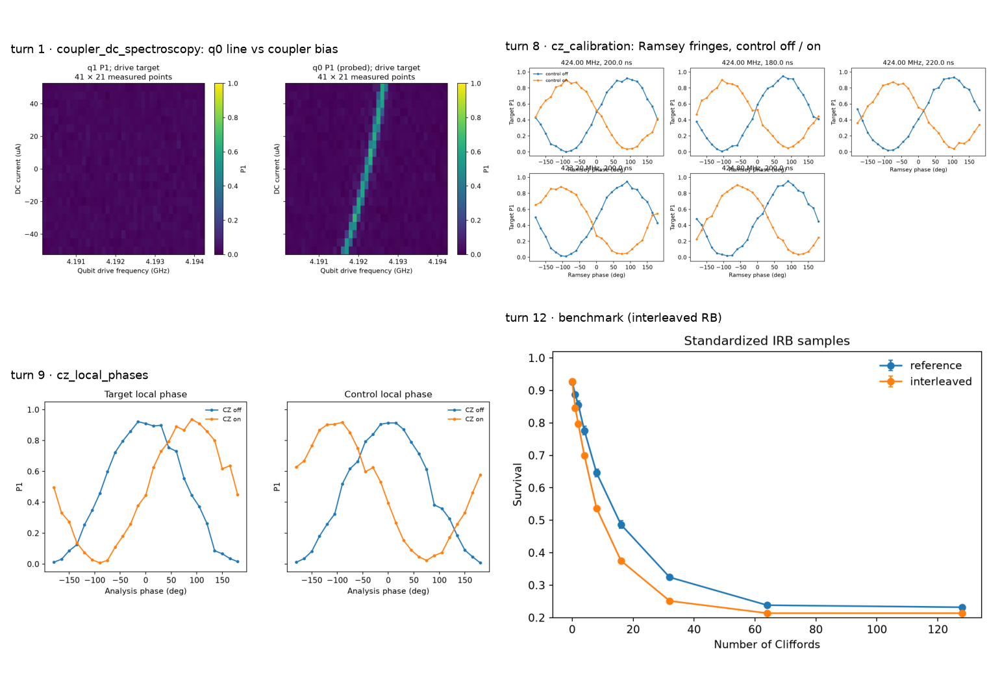

# One episode, turn by turn

Test chip `2q1c-3000000`, played by Qwen3.8-27B in a run with the discovery stage switched off
(`--no-discovery`: the qubit frequencies are given) and a calibration guideline appended to the system prompt
with `--prompt-addendum` (the guideline is not published). The model calibrates the CZ in 13 turns and 630 s of
simulated lab time. The final benchmark scores 0.970; the true fidelity is 0.972.

| Turn | Action | What the environment returned | Lab time |
|---|---|---|---|
| 1 | `coupler_dc_spectroscopy`: coupler bias ±50 µA × q0 drive 4.190–4.194 GHz | q0's line moves by 0.9 MHz across the bias range | 77 s |
| 2 | commit `parking_current` = 10 µA | committed; both qubits retuned at the new bias | 80 s |
| 3 | `cz_parametrization` (below) | `TRANSFER_BLOB`: best P2 = 0.92 at 427.1 MHz, amplitude 0.15 | 92 s |
| 4 | `cz_chevron` (below) | `RETURN_CANDIDATES`: full transfer at about 120 ns, back to \|11⟩ at about 200 ns | 50 s |
| 5–7 | commit `cz_pulse_frequency` = 424 MHz, `cz_pulse_amplitude` = 0.25, `cz_pulse_duration` = 200 ns | committed | – |
| 8 | `cz_calibration` at 5 working points around 424 MHz / 200 ns | conditional-phase fringes with the control off and on | 35 s |
| 9 | `cz_local_phases` | local phase corrections of 4.46 rad (control) and 1.56 rad (target) | 27 s |
| 10–11 | commit both local phases | committed | – |
| 12 | `benchmark` | F_lcb = 0.968, pass | 270 s |
| 13 | `stop` | final benchmark: score 0.970 | – |

## `cz_parametrization`: where is the |11⟩ ↔ |20⟩ transfer?

The request (turn 3) keeps the pulse length fixed at 280 ns and sweeps the drive frequency (41 points, 410–446
MHz) against the pulse amplitude (21 points, 0–1) at the parking current:

```json
{"coupler": "c0", "node": "cz_parametrization", "shots": 256,
 "sweeps": {"cz_pulse_frequencies": [4.28e8, 3.6e7, 41], "cz_pulse_amplitudes": [0.5, 1.0, 21],
            "cz_pulse_duration": 2.8e-7, "dc_currents": 1e-5}}
```

The environment returns the plot, panel (a) below, and a notebook entry of finite-shot summaries (trimmed):

```json
{"node": "cz_parametrization", "status": "TRANSFER_BLOB", "max_p2": 0.92, "median_p2": 0.11, "contrast": 0.81,
 "top_transfer_points": [{"frequency_Hz": 4.271e8, "amplitude": 0.15, "p2": 0.92},
                         {"frequency_Hz": 4.253e8, "amplitude": 0.25, "p2": 0.85},
                         {"frequency_Hz": 4.208e8, "amplitude": 0.40, "p2": 0.81}]}
```



Panel (a) is what the model sees. Panels (b) and (c) are noise-free simulations of the same scan, on the same
grid and on a finer grid; the model never sees them.

## `cz_chevron`: how long should the pulse be?

The request (turn 4) fixes the amplitude at 0.25 and sweeps the drive frequency (21 points, 419–433 MHz)
against the pulse duration (25 points, 40–1000 ns):

```json
{"coupler": "c0", "node": "cz_chevron", "shots": 256,
 "sweeps": {"cz_pulse_frequencies": [4.26e8, 1.4e7, 21], "cz_pulse_durations": [5.2e-7, 9.6e-7, 25],
            "cz_pulse_amplitude": 0.25}}
```

It returns (trimmed):

```json
{"node": "cz_chevron", "status": "RETURN_CANDIDATES", "max_p2": 0.87, "contrast": 0.70,
 "transfer_return_candidates": [
   {"frequency_Hz": 4.225e8, "peak_duration_s": 1.2e-7, "peak_probability": 0.85, "return_duration_s": 2.0e-7, "return_probability": 0.008},
   {"frequency_Hz": 4.232e8, "peak_duration_s": 8.0e-8, "peak_probability": 0.84, "return_duration_s": 1.0e-6, "return_probability": 0.004}]}
```



The model committed 424 MHz, amplitude 0.25 and 200 ns, then measured
the conditional phase and the local phases, and benchmarked the gate:


